# Распознавание маршрутов ровера

**«Вектор на Марс» · Задание 2 · Технический отчёт**

Отчёт описывает решение задания 2: воспроизводимый конвейер распознавания маршрутов ровера по кадрам с камеры БПЛА и бортовую программу, которая снимает поле и обрабатывает серию. Решение — это код: детектор ArUco и стрелок, построение графа, расчёт длины, сшивка кадров и полётные сценарии. Приложенные кадры служат примерами работы конвейера.

На входе конвейер получает кадр с метками и стрелками, на выходе выдаёт маршруты с цветом, числом стрелок, длиной и разметкой. Опасная пара меток исключается по спутниковому снимку. Конкретные маршруты и длины зависят от сцены; для приложенного полевого кадра они разобраны в разделе «Выбор маршрута на приложенном кадре».

## Конвейер

Обработка — одна детерминированная цепочка: кадр проходит фиксированный набор шагов и превращается в маршрут с цветом, номером метки и длиной. Ни один шаг не обучается на данных, поэтому один и тот же кадр и `config/routes.json` всегда дают один и тот же ответ, а промежуточные маски, граф и длины можно сохранить и проверить.

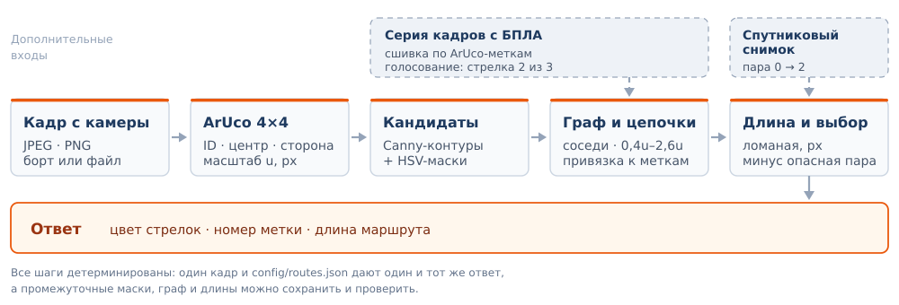

*Рис. 1. Кадр → ArUco → кандидаты стрелок → граф и цепочки → длина и выбор → ответ. Сверху — два дополнительных входа: серия кадров для сшивки и спутниковый снимок для исключения опасной пары меток.*

| Шаг | Что делает | Модуль |
|---|---|---|
| Метки | Читает ID, центр и сторону каждой ArUco-метки; сторона задаёт масштаб `u` для всех размерных фильтров. | `mars/aruco.py` |
| Кандидаты | Ищет замкнутые контуры на Canny-краях, а также в красной и синей HSV-масках; проверяет площадь, габариты, форму и удалённость от меток. | `mars/arrow_routes.py` |
| Граф | Связывает соседние стрелки по расстоянию и ориентации, убирает короткие замыкания, привязывает концы цепочки к меткам и определяет направление. | `mars/arrow_routes.py` |
| Длина | Считает длину ломаной по центрам меток и стрелок в пикселях; при известном масштабе переводит в метры. | `mars/arrow_routes.py`, `mars/scale.py` |
| Выбор | Исключает пару меток, прочитанную на спутниковом снимке, и сравнивает оставшиеся маршруты по длине. | `main.py`, `photo_mission.py` |
| Сшивка | Совмещает кадры серии по меткам и голосует по каждой стрелке, чтобы потеря на одном кадре не меняла счёт. | `mars/fusion.py` |

## Почему не машинное обучение

Задача решается геометрией, а не обучением. Это осознанный выбор, а не отсутствие ML в стеке.

- **Нет данных для обучения.** Поле снимается один раз, приложенная серия — семь кадров; ручная разметка стрелок на таком объёме даст модели меньше примеров, чем у неё параметров. Сеть выучила бы конкретную сцену, а не признак стрелки.
- **Признаки уже известны и проверяемы.** ArUco даёт точный ID, центр и масштаб, стрелка — замкнутый контур с известными ограничениями: площадь от 0,03u², заполненность от 0,45, 3–7 вершин. Эти условия записываются формулами, и каждое срабатывание можно объяснить.
- **Ответ должен повторяться и объясняться.** Судьи запускают одну команду и получают те же числа; по журналу видно, какой фильтр отсёк стрелку. У модели нет ни весов в репозитории, ни объяснения ошибки, а расхождение при повторном запуске нечем проверить.
- **Цена ошибки на полёте.** Конвейер работает на CPU борта без GPU и тяжёлых зависимостей. Ошибка локализуется тестом или промежуточной маской, а не остаётся «сеть не увидела»; 121 офлайн-тест проверяет детектор, сшивку и полётные сценарии.

ML уместен, если появятся сотни размеченных кадров с тенями, бликами и перекрытиями: сегментация стрелок могла бы стать вспомогательным шагом. Решение о маршруте всё равно остаётся геометрическим — граф, привязка к меткам и голосование по кадрам проверяют его независимо от того, как получена маска.

## Задача и исходные данные

Команда должна получить изображение поля с камеры БПЛА, распознать варианты движения ровера и выбрать кратчайший из допустимых. По условию второй задачи изображение, переданное с макета спутника, показывает маршрут, который требуется исключить. Итоговая запись должна включать идентификатор маршрута, цвет, длину и визуализацию. Для сравнения применяется одна метрика. [1]

| Материал | Как используется |
|---|---|
| Спутниковый кадр 347 × 446 | Две метки ArUco, одна цепочка белых стрелок. Определяет пару 0 → 2 для исключения. |
| Полевой кадр 1 920 × 2 560 | Четыре метки с ID 0, 2, 3 и 4. Журнал разработки содержит измерения, приложен PNG с итоговой разметкой. |
| Исходный вид поля и шесть JPEG 960 × 1 280 | Контрольная серия с изменёнными цветами стрелок и переставленными финишными метками. |
| Полётный журнал, 85 с | 75 записей телеметрии, взлёт, семь фото на высоте 2,7 м и посадка. |
| Семь бортовых кадров 1 080 × 720 | Два кадра пригодны для сшивки; в примере подтверждены 13, 8 и 3 стрелки. |
| Два журнала разработки | Подтверждают ранние прототипы, наблюдения на поле, правки кода, результаты тестов и интеграцию. |

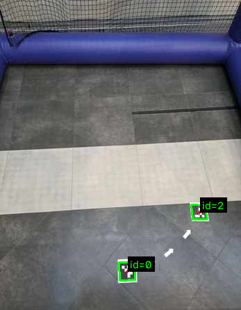
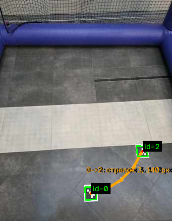

*Рис. 2. Слева размечены метки, справа оранжевая ломаная соединяет их через три белые стрелки. Подпись на изображении округлена до 140 px. [2, 3, 5]*

## От меток к первому маршруту

### Встраивание ArUco

К началу разработки в репозитории уже присутствовали сегментация сплошных цветовых линий, измерение их скелета и конфигурация маршрутов. Для поля из отдельных стрелок добавили самостоятельные модули `mars/aruco.py` и `mars/arrow_routes.py`. Первый возвращает метки и их геометрию, второй принимает кадр и список меток. Так одни и те же результаты детекции можно использовать для построения маршрута, измерения масштаба и рисования разметки. [2]

На спутниковом кадре проверили словари OpenCV. В семействах 4×4 читались метки **0** и **2**. В качестве настраиваемого словаря по умолчанию выбрали `DICT_4X4_50`. `ArucoDetector` работает на градациях серого с субпиксельным уточнением углов. Центр вычисляется по четырём углам, размер в пикселях — как средняя длина четырёх сторон. На диагностическом PNG метка обведена и подписана ID.

### Прототип для белых стрелок

Первая версия выделяла яркие слабонасыщенные области в HSV (`V ≥ 160`, `S ≤ 70`), подавляла шум морфологией и отбрасывала зоны вокруг меток. При проверке пары меток центры стрелок проецировались на линию между ними. Допускались кандидаты в прямом коридоре с согласованным направлением и без крупных разрывов. PCA давал продольную ось контура, профиль ширины помогал определить наконечник.

Первую версию проверили на одном и двух параллельных маршрутах, разных направлениях стрелок, шуме и некорректных входных кадрах. При борьбе с ложными связями между метками сузили коридор, сократили допустимый промежуток между стрелками и добавили проверку отклонения от прямой. На спутниковом кадре версия `69c6a24` нашла 0 → 2 с тремя стрелками и длиной 140,4 px. В её журнале — 54 пройденных теста в общей сборке. [2]

| Веха | Что появилось |
|---|---|
| ArUco и отдельная разметка | Контур, центр и ID каждой метки, сортировка результатов по ID. |
| `d0260df` | В репозитории зафиксированы подписи меток и пример размеченного спутникового изображения. |
| `69c6a24` | Отдельный детектор цепочки белых стрелок, рассчитанная длина и наложение маршрута на кадр. |

## От прямой к графу

### Что показал первый запуск на поле

На кадре 1 920 × 2 560 присутствуют три цепочки, две из них заметно изгибаются. Прямой детектор вернул лишь один результат 0 → 2 с тремя стрелками и длиной 832,1 px. Белая маска отбрасывала насыщенные стрелки, а светлые области плитки попадали в диагностику. Белая дуга выходила за геометрический коридор. Значение 832,1 px относится к этому раннему прогону. [2]

Команда указала в диалоге, что на отладочном изображении пропущены белые стрелки и отмечены блики пола. Проверка по топ-хату яркости и разности с локальным фоном показала, что единый порог плохо переносится с тёмной плитки на светлую полосу. При переходе к контурам удалось использовать границы печатных стрелок. Синие и красные стрелки с малым контрастом в градациях серого дополнительно искали по цветовым маскам. [2, строки 9 593–10 330]

### Что изменилось в модели маршрута

На левой цепочке чередуются красные и белые стрелки. Белые встречаются и на других цепочках. Связь стали определять по положению и ориентации соседних стрелок. Цвет сохранили как атрибут для отчёта. Граф позволил проходить изгибы локальными шагами и сопоставлять начало и конец цепочки с метками.

| Ограничение прототипа | Решение в новой версии |
|---|---|
| Светлая плитка выглядела как белая стрелка | Контуры Canny, геометрические ограничения и обрезка зон возле меток. |
| Некоторые цветные стрелки терялись на сером фоне | Параллельные маски красного и синего в HSV. |
| Контур одной стрелки встречался несколько раз | Объединение кандидатов по близким центрам с приоритетом площади. |
| Прямой коридор терял дуги | Соседний граф, удаление обходящих промежуточную стрелку рёбер и привязка концов к меткам. |

При продолжении работы сначала воспроизвели ранний спутниковый результат. После уточнения команды проверку вернули к последнему полевому кадру. Граф уже находил три цепочки, но два теста на цвет и размер стрелок ещё не проходили. [3, строки 8 938–9 727]

## Как устроен детектор


### Кандидаты по контуру и цвету

Кадр приводится к BGR. Для геометрии применяется полутоновое изображение с билатеральным фильтром. Порог Canny не фиксирован: верхний порог равен `0,75` от 99-го процентиля градиента кадра в пределах `25…90`, нижний — `0,4` от верхнего. Границы расширяются эллиптическим ядром 3 × 3. Дополнительные источники кандидатов — красная и синяя маски HSV с замыканием 3 × 3 и маска белой краски. Из четырёх источников извлекают контуры; на каждом проверяют площадь, габариты, геометрию и положение. [3, строки 9 763–10 435]

Пороги цвета тоже следуют за кадром. Красная маска допускает `H ≤ 14` или `H ≥ 163`, синяя — `95 ≤ H ≤ 140`. Порог насыщенности красного равен `0,55` от 99-го процентиля `S` в пределах `40…110`, синего — `0,32` от того же процентиля в пределах `35…90`; нижний порог яркости — `0,25` от 95-го процентиля `V` в пределах `30…60`. Поэтому смена экспозиции не прячет цветную краску.

Белая краска не имеет устойчивого оттенка, поэтому для неё строится локальный адаптивный порог по яркости: блок `2u` (не меньше 15 и не больше 151 пикселя), константа `12`, только при `S < 40`. Вертикальное размыкание `0,3u` убирает тонкие светлые швы, которые иначе сливаются со стрелкой. Белый кандидат принимается, только если его сторона не меньше `0,65u`, заполненность выпуклой оболочки лежит в `0,75…0,90`, не меньше `80%` границы контура совпадает с краем, а яркость заливки превышает локальный фон не меньше чем на `20` единиц. Так тень стрелки и светлое пятно пола не становятся стрелкой.

Пусть **u** — медиана значений `side_px` у найденных ArUco-меток. Использование u адаптирует размерные фильтры к масштабу изображения.

| Проверка в рабочей версии | Допуск |
|---|---|
| Площадь контура | От `max(0,03u², 25 px²)` до `u²`. |
| Ширина и высота ограничивающей рамки | Каждая в пределах `0,2u–1,8u`. Отношение большей стороны к меньшей до 2,8. |
| Заполненность выпуклой оболочки | Площадь контура к площади оболочки от 0,45. |
| Упрощённый контур | 3–7 вершин при допуске 4% длины периметра. |
| Белая краска | Сторона от `0,65u`, заполненность `0,75–0,90`, совпадение границы с краем от `80%`, локальный контраст от `20`. |
| Граница кадра и зона метки | Отступ рамки 1% с каждой стороны изображения. Расстояние от центра кандидата до каждой метки не меньше стороны этой метки. |
| Объединение дубликатов | Среди центров ближе `0,3u` сохраняется кандидат с большей площадью. |

Центр стрелки берётся из её ограничивающей рамки. PCA по точкам контура определяет главную ось. Поперечная ширина в четырёх участках оси показывает, какой конец шире. При неразличимом наконечнике его вклад в выбор направления нулевой. Цвет классифицируется по средним каналам BGR внутри очищенной маски: `red`, если красный канал больше `1,35` от максимума зелёного и синего и выше `40`; `blue`, если синий больше `1,15` от максимума красного и зелёного и выше `35`; иначе `white`. Отношения каналов, а не абсолютные уровни, сохраняют метку при затемнении кадра.

## Граф и длина маршрута


1. **Связи между стрелками.** Вершины — центры принятых стрелок. Две стрелки совместимы на расстоянии `0,4u–2,6u`, если линия связи согласована с осями обеих стрелок. Связь не проводится через пустую зону вокруг метки радиусом `1,5u`: это граница между двумя маршрутами, заканчивающимися у одной метки. Каждая вершина предлагает до двух ближайших совместимых соседей, связи симметризуются.
2. **Удаление коротких замыканий.** Прямое ребро A–C удаляется, если через общего соседа B путь A–B–C не длиннее прямого ребра более чем на 12%. Из компонент связности строятся упорядоченные цепочки с предпочтением продолжения текущего направления.
3. **Привязка к меткам.** Каждый конец цепочки привязывается только к ближайшей метке; расстояние до неё не больше `3u`, метки на концах должны быть разными. Внутренняя стрелка ближе `0,9u` к краю кадра означает, что цепочка обрезана, и такой кандидат отбрасывается. По умолчанию требуются минимум две стрелки. Для одной пары сохраняется одна цепочка, преимущество получает цепочка с большим числом стрелок. Использованные стрелки не назначаются повторно.
4. **Направление и длина.** Знаки наконечников голосуют за порядок обхода. При отрицательной сумме цепочка разворачивается. В ломаную входят центр стартовой метки, центры стрелок по порядку и центр финишной метки.

```python
length_px = sum(
    math.dist(polyline[index], polyline[index + 1])
    for index in range(len(polyline) - 1)
)
length_m = None if px_per_meter is None else length_px / px_per_meter
```

Длина включает промежутки между стрелками. Для перевода в метры CLI может оценить масштаб по стороне метки **14 см**, указанной командой. Одна медианная шкала даёт приближение при перспективе, поэтому в сравнении используются пиксели одного полевого кадра. Ломаная также может спрямлять дуги между стрелками. [2, 3]

## Две регрессии и их исправление

После переработки два теста сообщали `2 != 3`. Дополнительный вывод показал, что третья стрелка терялась **до связывания графом**. Проверка каждого промежуточного фильтра дала измеримые причины. [3, строки 10 630–11 046]

| Регрессия | Что было видно при диагностике |
|---|---|
| Смешанная палитра | Из цепочки выпала красная стрелка. На сером фоне с яркостью около 70 красный после перевода в серый дал около 76. Canny не выделил её контур, однако красная HSV-маска дала контур с заполненностью 0,526. Старый порог 0,60 его отсёк. |
| Разные размеры стрелок | Из трёх белых стрелок выпала наиболее длинная. Подходящий внешний контур имел заполненность 0,501 и тоже не достигал 0,60. |

Имена проверок в коде — `test_mixed_colour_arrows_form_one_route` и `test_different_arrow_sizes_form_one_route`.

Порог `MIN_SOLIDITY` снизили с **0,60** до **0,45**. Остались проверки площади, габаритов, формы многоугольника, границ кадра, зон меток и связности. После правки проверили тесты и повторили оба исторических прогона. Изменение порога устранило две тестовые регрессии. Полученные перед правкой три полевые цепочки и спутниковая пара 0 → 2 сохранились.

| Проверка | Наблюдение в журнале |
|---|---|
| Рабочая копия до правки | 57 тестов, две ошибки распознавания стрелок. |
| Рабочая копия после правки | 57 тестов, `OK`. Спутник 0 → 2, три белые стрелки, 139,8 px. На поле три цепочки, 13, 8 и 3 стрелки. |
| После интеграции | Локальная правка `03d2014` перенесена поверх семи коммитов команды. 78 тестов получили `OK`, публикация правки в `main` зафиксирована как `6b5f2e5`. |
| Текущая редакция | 121 тест, `OK`; добавлены наборы пульта, миссии, журнала и сшивки кадров. |

78 — размер набора тестов общей сборки по записи запуска. В него входят проверки нескольких модулей. Это число не является оценкой точности на 78 полевых снимках. [3, строки 11 553–11 696] В текущей сборке 121 тест, все проходят офлайн за 1,7 с.

## Разметка полевого кадра

Журнал финального запуска фиксирует четыре метки `0, 2, 3, 4` и три цепочки. Приложенный PNG показывает ломаные и подписи на кадре 1 920 × 2 560. Цвет линий выбран для различимости на разметке. Цвета стрелок в таблице следующего раздела относятся к самому полю.

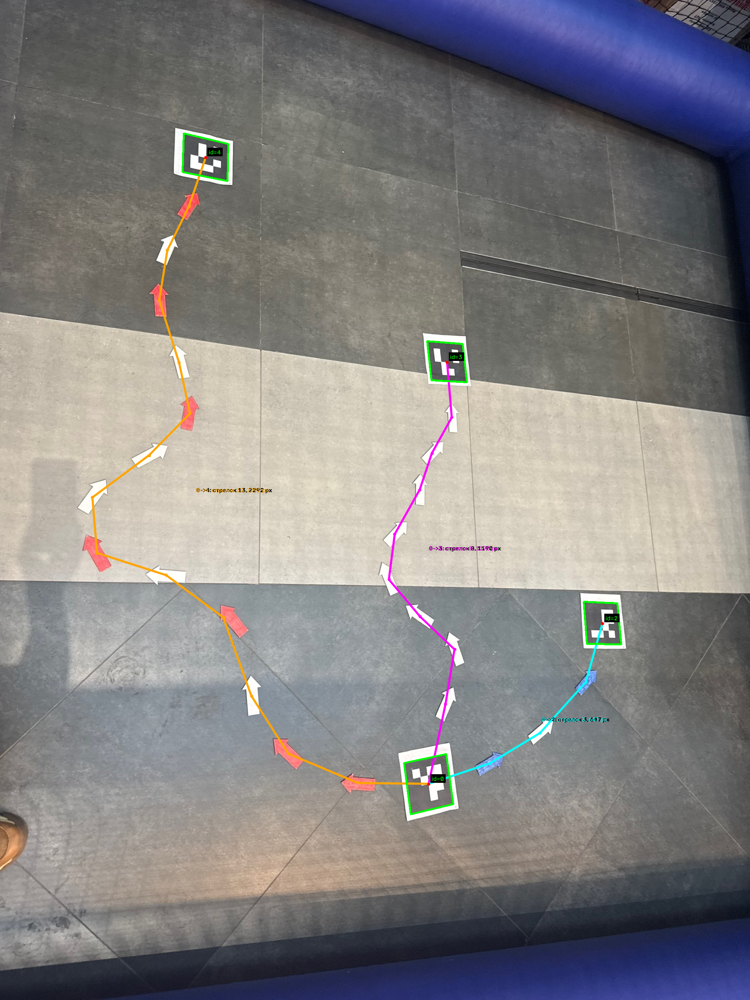

*Рис. 3. Оранжевая линия — 0 → 4 слева, пурпурная — 0 → 3 в центре, голубая — 0 → 2 справа. Зелёным обведены ArUco-метки. [3, 5]*

В отдельной диагностике журнала ещё четыре кандидата исключены при построении маршрутов. Разметка подтверждает итоговые цепочки и позволяет проверить их визуально. Значения с десятыми берутся из консольного вывода. [3, строки 11 829–11 888]

## Выбор маршрута на приложенном кадре

Длины ломаных посчитаны одним способом на одном полевом кадре. Для исключения используется пара меток `0 → 2`, прочитанная на спутниковом кадре.

| Пара меток | Стрелки на поле | Длина, px | Решение |
|---|---|---:|---|
| 0 → 2 | 3 (2 синие и 1 белая) | 647,1 | Исключён по спутниковому снимку. |
| 0 → 3 | 8 белых | 1 189,7 | Кратчайший из оставшихся. |
| 0 → 4 | 13 (7 красных и 6 белых) | 2 292,2 | Длиннее маршрута 0 → 3. |


**Результат на приложенном кадре.** Старт — метка №0, финиш — №3, цвет стрелок — белый, длина — **1 189,7 px**. Это на **1 102,5 px**, или примерно на **48,1%**, меньше длины 0 → 4. Значения 647,1 px и 139,8 px относятся к паре 0 → 2 на разных кадрах и в разных масштабах. [1, 3]

Историческая команда `mars.arrow_routes` выводит найденные цепочки. Выбор после исключения выполнен по этому выводу и условию задачи.

## Как подготовили тестовые кадры

За основу взяли вид исходного поля 960 × 1 280. Мини-отчёт предписывает сохранить ракурс, положение и направление стрелок, а также стартовую метку №0. В каждом из шести вариантов менялись цвета отдельных стрелок и размещение финишных ID 2, 3 и 4 между концами тех же трёх цепочек. Цель — проверить, что привязка выполняется к прочитанным ID, а связывание сохраняется при смене цвета отдельных стрелок. [4]

### Две серии

1. **`original-01…03.jpg`.** Три версии с красными, синими и белыми стрелками. По мини-отчёту цвета распределяли заново между отдельными стрелками.
2. **`mixed-01…03.jpg`.** Три версии с исходной палитрой и тремя дополнительными цветами в каждом кадре. Набор новых цветов между кадрами меняется.

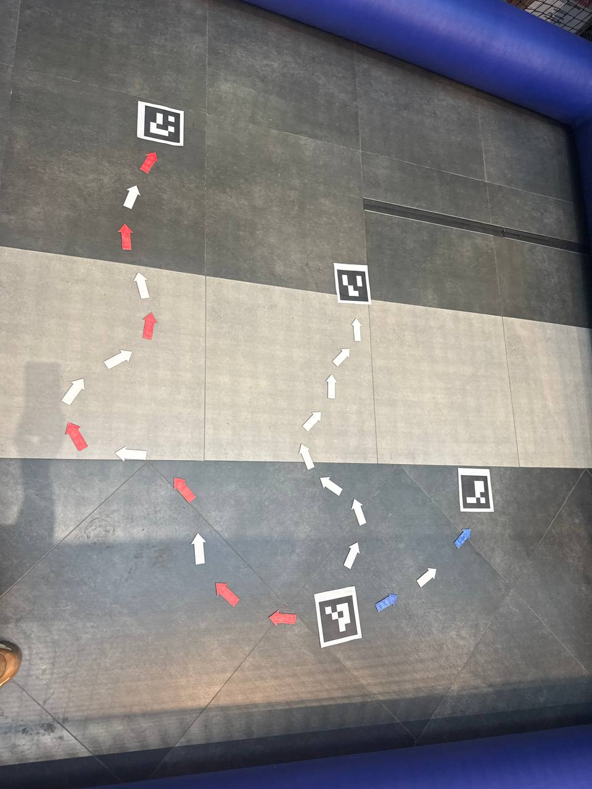

*Рис. 4. Приложенная основа синтетической серии. У кадра сохранены геометрия цепочек и естественный фон поля. [4]*

В наборе даны готовые JPEG и запланированные перестановки. Этого достаточно, чтобы повторить проверку детектора на тех же кадрах. Для точного повторения подготовки кадров нужны исходник генерации, маски редактирования и начальное состояние случайного выбора.

## Шесть синтетических кадров

В таблице перечислены контрольные метки слева направо, по положению финишей на изображении. Метка старта №0 сохранена в каждом кадре. [4]

| Кадр | Палитра | Финиши слева направо |
|---|---|---|
| `original-01.jpg` | Красный, синий, белый | 3, 4, 2 |
| `original-02.jpg` | Красный, синий, белый | 2, 3, 4 |
| `original-03.jpg` | Красный, синий, белый | 4, 2, 3 |
| `mixed-01.jpg` | Исходные + зелёный, оранжевый, пурпурный | 3, 2, 4 |
| `mixed-02.jpg` | Исходные + жёлтый, бирюзовый, фиолетовый | 2, 4, 3 |
| `mixed-03.jpg` | Исходные + салатовый, оранжевый, розовый | 2, 3, 4 |

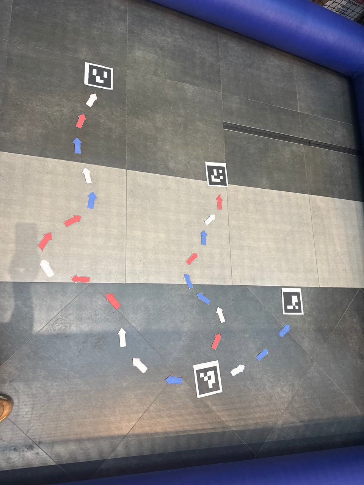
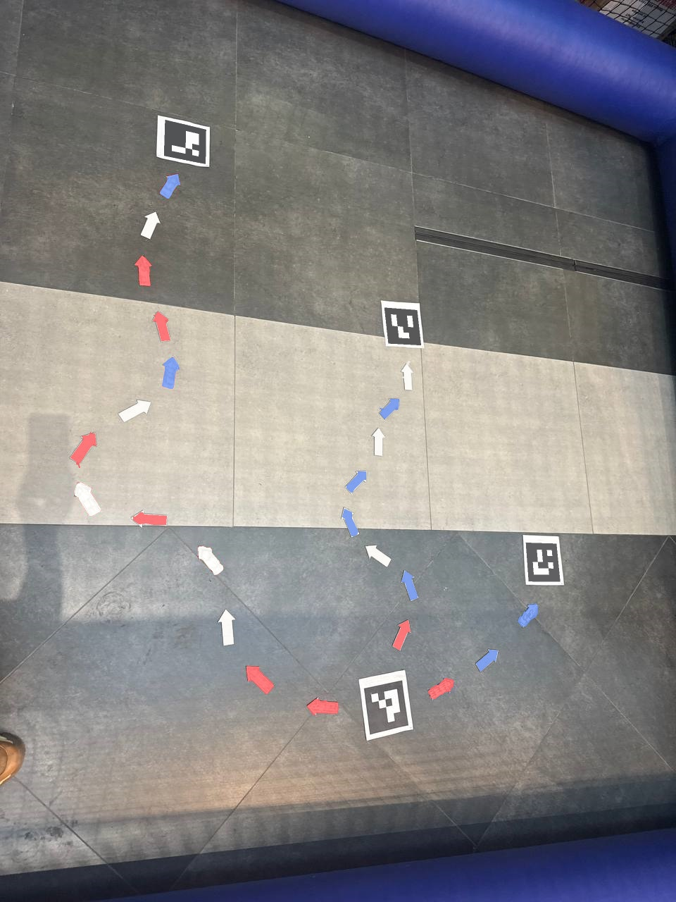
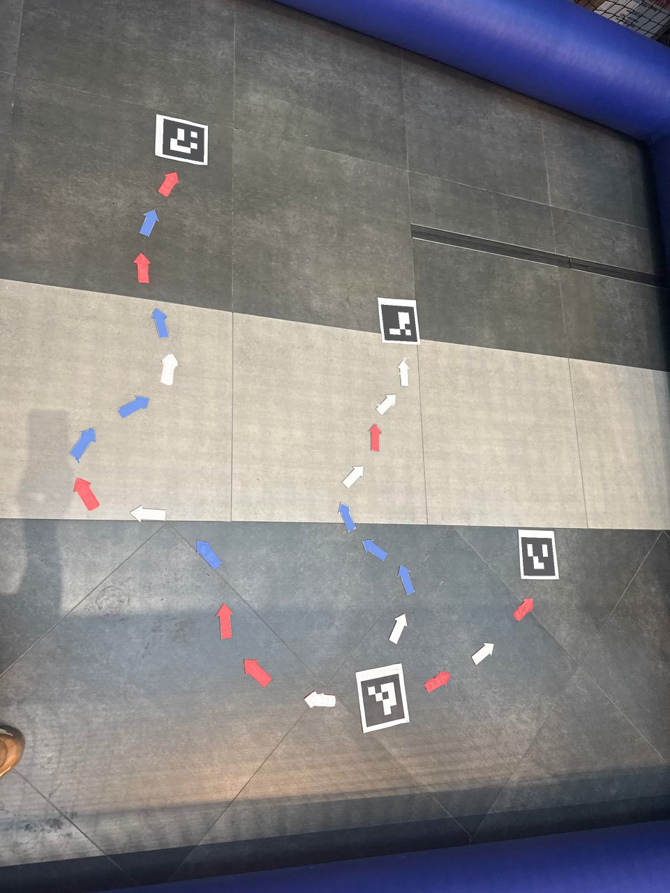
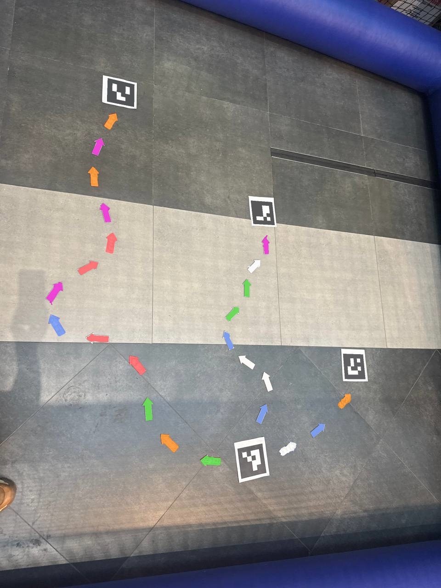
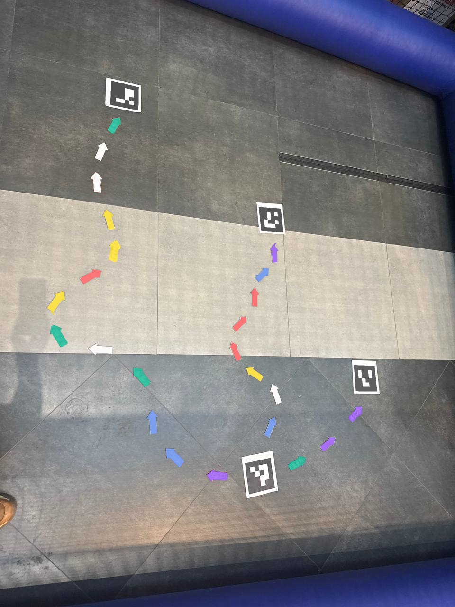
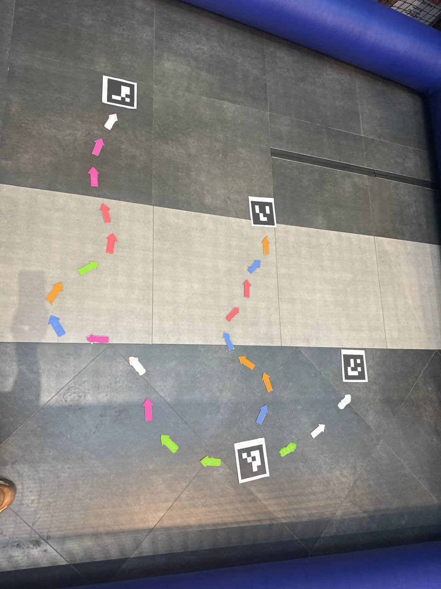

*Рис. 5. Сверху `original-01…03`, снизу `mixed-01…03`. Пары ID для каждого кадра определяются новым положением финишей.*

## Что проверено на тестовых данных

Для повторной проверки восстановлены модули ArUco, масштаба и стрелочных маршрутов из записей сессий. В двух восстановленных наборах 32 теста. Локально **30 прошли**, два теста со спутниковым исходником пропущены из-за отсутствия исходного JPEG. Повторение двух регрессионных проверок дало 2 ошибки при 0,60 и 0 при 0,45. [6]

### Прогон семи приложенных JPEG

На всех семи изображениях прочитаны ID 0, 2, 3 и 4. Порядок финишных меток во всех шести вариантах совпал с мини-отчётом. В таблице для каждого положения финиша указаны **направленная пара · число стрелок · длина в px**. [4, 6]
| Кадр | Левый маршрут | Средний маршрут | Правый маршрут |
|---|---|---|---|
| Основа | 0 → 4 · 13 · 1 151,7 | 0 → 3 · 8 · 594,6 | 0 → 2 · 3 · 323,9 |
| `original-01.jpg` | 0 → 3 · 13 · 1 150,0 | 0 → 4 · 8 · 595,9 | 2 → 0 · 3 · 324,4 |
| `original-02.jpg` | 0 → 2 · 13 · 1 150,3 | 0 → 3 · 8 · 595,9 | 4 → 0 · 3 · 324,4 |
| `original-03.jpg` | 0 → 4 · 13 · 1 143,3 | 0 → 2 · 8 · 595,4 | 0 → 3 · 3 · 324,1 |
| `mixed-01.jpg` | 0 → 3 · 12 · 1 139,6 | 0 → 2 · 8 · 596,0 | 0 → 4 · 3 · 324,4 |
| `mixed-02.jpg` | — | 0 → 4 · 8 · 595,6 | 3 → 0 · 2 · 322,9 |
| `mixed-03.jpg` | — | 0 → 3 · 7 · 590,4 | 0 → 4 · 3 · 324,4 |

Все три пары без учёта направления найдены на **4 из 6** синтетических кадров. На всех кадрах базовой палитры сохранены количества 13, 8 и 3. На `mixed-01` по левой ветке найдено 12 стрелок. На `mixed-02` и `mixed-03` левая ветка не сформировалась, хотя у каждой из них 11 из 13 опорных центров левой ветки имели кандидата в радиусе 0,35u. На этих кадрах потери видны уже на этапе отбора стрелок.

На `original-01`, `original-02` и `mixed-02` короткая ветка получилась направленной к старту. Синтетическое условие сохраняло ориентацию стрелок, поэтому наличие пары и правильность её направления проверяются отдельно. Цвет не связывает стрелки в графе. При этом классификатор выводит только `red`, `blue` и `white`, в том числе для кадров с расширенной палитрой.

## Устойчивость к освещению

Палитра серии меняется при общей геометрии и ракурсе. Это упражнение на чтение меток и устойчивость связывания к перекраске. Оно не моделирует движение камеры, смаз, сильные блики, затенение или перекрытие стрелок.

Для отдельной диагностики умножили значения всех каналов исходного кадра 960 × 1 280 на заданный коэффициент с ограничением диапазона 0–255. Геометрию кадра и параметры детектора сохраняли.

| Множитель яркости | ArUco | Что вернул детектор |
|---|---|---|
| ×0,60 | Метки 0, 2, 3 и 4 | Три цепочки, 13, 8 и 3 стрелки. |
| ×1,00 | Метки 0, 2, 3 и 4 | Три цепочки, 13, 8 и 3 стрелки. |
| ×1,30 | Метки 0, 2, 3 и 4 | Только 2 → 0, 3 стрелки, 323,5 px. У 20,5% пикселей ограничен хотя бы один канал. |

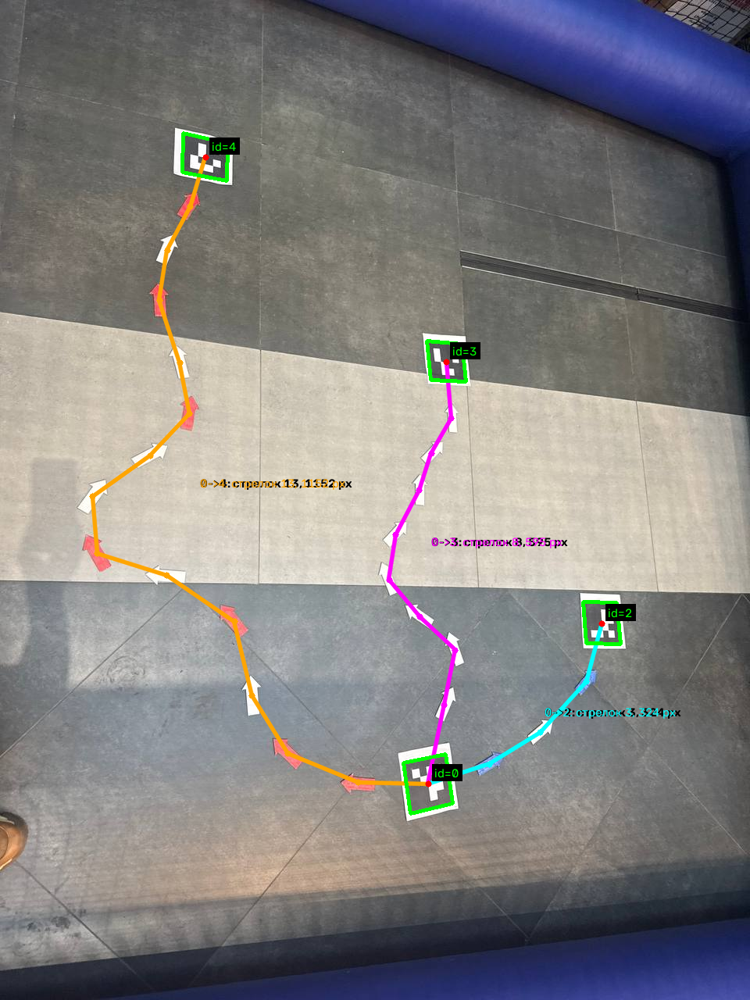
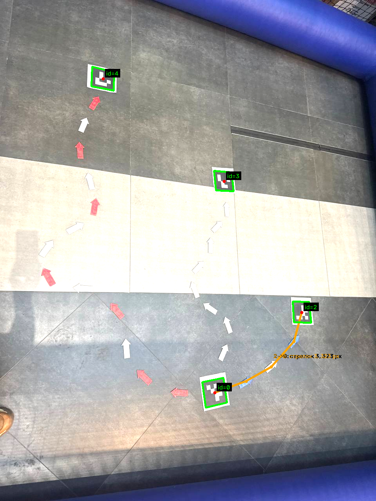

*Рис. 6. Слева разметка исходного кадра, справа результат при ×1,30. Детектор читает все метки, но сохраняет только правую цепочку. [6]*

Освещение влияет на контраст границ и на числовые значения HSV. В полевом журнале смена светлой и тёмной плитки уже приводила к пропускам белых стрелок и ложным кандидатам. Контуры и отдельные цветовые маски дополняют друг друга, но при потере границы или цветового контраста цепочка может разорваться. Кроме того, фильтры размеров зависят от медианы стороны меток, а шаг дилатации 3 × 3 и пороги Canny зафиксированы.

Этот диагностический опыт показывает чувствительность к усилению яркости на одном кадре. Освещение на площадке также меняет тени, отражения и баланс белого.

## Бортовая программа

### Слои и границы ответственности

Полётная часть отделена от зрения. `mars/drone.py` — единственное место, где импортируется `pioneer_sdk2`; импорт ленивый, поэтому обработка кадров и тесты работают на машине без SDK. `DroneLink` инкапсулирует `Pioneer`, `arm`/`takeoff`/`land`, body-fixed скорости, телеметрию LPS, камеру, сохранение фото и сервопривод. `Pioneer()` при неудачном TCP вызывает `exit()`, поэтому обёртка перехватывает `SystemExit` и возвращает понятную ошибку `DroneUnavailable` вместо завершения процесса.

Над этим слоем находятся `mars/teleop.py` (клавиши → скорости), `mars/flightlog.py` (JSONL-журнал), `drone_tui.py` (curses-пульт) и `mars/mission.py` вместе с `photo_mission.py` (автономная миссия). `mars/flight.py` даёт тонкий `FlightAdapter` и симулятор, чтобы миссию можно было прогнать без железа. `mars/fusion.py` относится только к зрению и не знает о полёте.

| Модуль | Роль |
|---|---|
| `mars/drone.py` | SDK, телеметрия, камера, фото, сервопривод, защитные ошибки. |
| `drone_tui.py`, `mars/teleop.py` | Ручной полёт, импульс 0,35 с, защита по высоте, журнал. |
| `mars/mission.py`, `photo_mission.py` | Взлёт, набор высоты, остановки с фото, посадка, разбор кадров. |
| `mars/fusion.py` | Сшивка кадров по меткам и голосование по стрелкам. |

### Пульт

Пульт отправляет body-fixed скорости: `W/S` и `A/D` — горизонталь, `R/F` — высота, `Q/E` — рыскание. Скорость меняется клавишами `+`/`-`, предел 1,5 м/с. Отпущенная клавиша обнуляет ось через 0,35 с, поэтому потеря терминала не оставляет дрон лететь. `T` и `L` — взлёт и посадка, `X` — выход с автоматической посадкой, `--max-altitude` (3 м) блокирует набор выше предела. `P` сохраняет кадр, сразу прогоняет его через детектор и показывает второй по длине маршрут; полный список пишется в журнал событием `routes`. `V` открывает окно камеры.

Камера управляется физическими углами: `0°` — горизонт, `−90°` — вниз; клавиши `1/2/3/4` дают −90, −60, −30 и 0°, `[`/`]` — крайние положения. Шкала SDK сдвинута (горизонт +30, вниз −80), пересчёт линейный. Команда уходит целым числом градусов с приоритетом `high` и повторяется раз в секунду, иначе борт возвращает стабилизацию. `set_angle()` подтверждает только отправку датаграммы в `/tmp/servo.sock`, а не фактический угол; поэтому наклон доступен лишь в режиме `--local` на борту.

Журнал `logs/flight_*.jsonl` хранит телеметрию, команды, скорости, события камеры и фото. Запись пригодна для повторного разбора: по ней восстанавливаются высота, путь и моменты съёмки.

### Автономная фото-миссия

`photo_mission.py` выполняет последовательность: наклон камеры вниз, взлёт, набор высоты закрытым контуром, перелёт к точке с остановками, съёмка на каждой остановке, снижение и полная посадка. Высота по умолчанию 2,7 м, точка — 0,5 м по `x` и `y` от места взлёта, остановок пять: 0, 25, 50, 75 и 100% пути. На остановке дрон делает три кадра: по курсу подхода и после разворота вправо на 45° и 90°, затем возвращается на курс подхода и продолжает маршрут; `--no-turn-photos` оставляет один кадр. Разворот — закрытый контур по yaw из LPS с допуском 3° и пределом 20 с; курс снимается один раз после набора высоты, поэтому остаточная ошибка возврата не накапливается. На каждой остановке пауза 1,5 с и до трёх попыток фото; между остановками высота удерживается тем же пропорциональным регулятором. Углы съёмки задаёт `--turn-angles`, число остановок — `--stops`. Направление перелёта задаёт `--quadrant` (`auto`, `ne`, `nw`, `se`, `sw`); `auto` берёт знаки из `--target-x` и `--target-y`.

Горизонтальный полёт идёт по LPS: координаты точки взлёта запоминаются после взлёта, мировые скорости поворачиваются на текущий yaw и подаются как body-fixed. Допуск по точке 0,08 м, таймаут 60 с на отрезок. Если LPS или высота пропали, миссия останавливается и выполняет аварийную посадку; Ctrl+C также приводит к посадке. Коды возврата: 0 — успех, 1 — ошибка миссии или нет фото, 2 — неверные параметры или нет связи, 130 — прерывание.

Флаг `--expect-arrows` необязателен: он тихо оставляет для сшивки только кадры с четырьмя метками, где набор чисел стрелок совпал с ожидаемым (по умолчанию 13, 8, 3). Если совпадений нет, анализ идёт как без флага, поэтому подсказка не подменяет результат.

Приложенная серия снята пультом, а не автономной миссией: в журнале нет событий `mission_start`, зато есть `tui_started` и семь событий `photo`. Автономная миссия проверена на симуляторе и в unit-тестах; её зрение использует тот же детектор и ту же сшивку, что описаны в этом отчёте.

### Сшивка кадров

Считать маршруты в каждом кадре и голосовать по итоговым числам нельзя: пропуски односторонние, поэтому три кадра, потерявшие разные стрелки, всё равно дадут неверное число. Кадры совмещаются по центрам ArUco-меток гомографией; для неё нужны минимум четыре общие метки. Преобразование проверяется по углам меток: при ошибке одной метки или наклонном кадре оно не проходит, и кадр исключается. Затем стрелки всех кадров кластеризуются в координатах опорного кадра, и стрелка считается настоящей только при поддержке нужного числа кадров: 2 из 3, 3 из 4, 3 из 5 и так далее. Цепочки строятся заново уже по подтверждённым стрелкам.

Опорным становится самый резкий кадр в наибольшем наборе меток, общем хотя бы для двух снимков. Если гомография не сошлась или подтверждено меньше двух стрелок, скрипт откатывается на лучший одиночный кадр. Поэтому потеря стрелки на одном кадре и светлое пятно на другом не меняют счёт, а полностью несовместимые кадры не смешиваются.

### Полётная серия

Серия ниже — пример работы на конкретной сцене, а не эталонный ответ: маршруты и длины зависят от кадра.

Журнал `flight_20260807_154803.jsonl` фиксирует один полёт 7 августа 2026 г.: подключение к `10.42.0.1:20556`, взлёт в 15:48:09, набор высоты, семь фото с 15:49:04 по 15:49:14 и посадку в 15:49:24. Запись длится 85 с и содержит 75 отсчётов телеметрии, 49 команд скорости и 7 событий `photo`. Максимальный набор высоты — 2,74 м над точкой старта, путь по LPS к моменту посадки — 4,7 м, напряжение — с 8,44 до 8,14 В. В журнале также видны девять отклонённых повторов взлёта с ответом «команда запрещена»: уже находящийся в воздухе борт не принял команду, и полёт продолжился.

Бортовые кадры имеют размер 1 080 × 720. На пяти кадрах метка `0` обрезана краем кадра, поэтому такие снимки не годятся для сшивки. Рабочих кадров два: на них видны все четыре метки, и они образуют общий набор. Сшивка использовала оба кадра, по 24 стрелки в каждом, подтвердила 24 и отбросила один кандидат.

| Пара меток | Стрелки на бортовой серии | Длина, px | Решение |
|---|---|---:|---|
| 0 → 2 | 3 (2 синие и 1 белая) | 285,9 | Исключён по спутниковому снимку. |
| 0 → 3 | 8 белых | 493,6 | Кратчайший из оставшихся, второй по длине. |
| 0 → 4 | 13 (7 красных и 6 белых) | 863,1 | Длиннее маршрута 0 → 3 на 369,5 px (42,8%). |

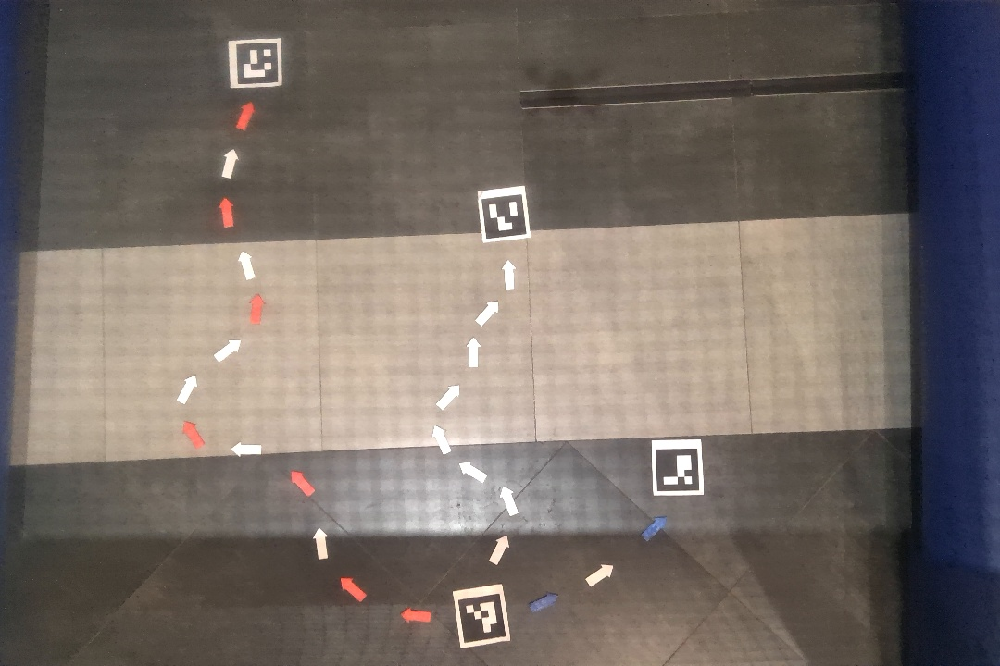

*Рис. 7. Рабочий кадр 15:49:14 без разметки: все четыре метки в кадре. На остальных пяти снимках серии метка 0 обрезана. [8]*

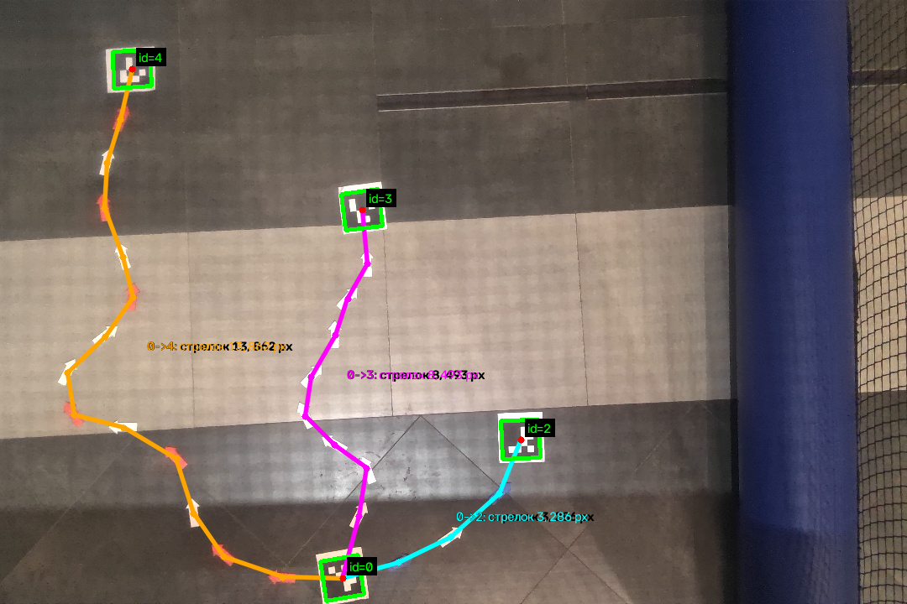

*Рис. 8. Разметка другого рабочего кадра, 15:49:09: оранжевая линия — 0 → 4, пурпурная — 0 → 3, голубая — 0 → 2. Подписи содержат число стрелок и длину в пикселях. [8]*

Длины бортовой серии нельзя сравнивать с 1 189,7 px полевого кадра 1 920 × 2 560 напрямую: другой ракурс, разрешение и высота. Сравнение выполняется внутри одной серии, где все три маршрута измерены одним способом. Результат по серии — **0 → 3, восемь белых стрелок, 493,6 px**; он совпадает с результатом по полевому кадру.

### Ограничение автоматического выбора

И пульт, и фото-миссия печатают **второй по длине** маршрут (`second_longest_route`). На этом поле такой выбор совпал с кратчайшим допустимым: исключаемая спутниковая пара `0 → 2` оказалась самой короткой из трёх. Если опасный маршрут не самый короткий, второго по длине недостаточно — нужен явный список исключаемых пар меток. Сейчас исключение `0 → 2` выполнено в анализе отчёта, а в бортовом CLI отдельного параметра для пары нет; это следующий шаг перед зачётным полётом.

## Запуск и бортовая часть

### Воспроизведение обработки кадра

Команды запускаются из корня репозитория с установленными NumPy и OpenCV с поддержкой `cv2.aruco`. Словарь можно переопределить через `--dict`. Опция `--out` сохраняет разметку PNG. Для сравнения в пикселях физический масштаб не требуется.

```powershell
python -m mars.aruco "samples/image.jpg" --out "image_markers.png"
python -m mars.arrow_routes "field.jpg" --out "field_route.png"
python -m unittest discover -s tests
```

| Вход | Выход |
|---|---|
| `mars.aruco`, изображение JPEG или PNG | Количество и ID меток, центры и размеры, аннотированный файл по запросу. |
| `mars.arrow_routes`, изображение с метками и стрелками | Список цепочек, ID начала и конца, число стрелок по категориям и длина. Изображение с ломаной по запросу. |
| Спутниковый результат и список полевых цепочек | Исключение спутниковой пары и сравнение оставшихся по длине в пикселях. |

### Пульт и автономная миссия

```powershell
python drone_tui.py --dry-run
python drone_tui.py
python photo_mission.py --dry-run
python photo_mission.py --local
python photo_mission.py --local --altitude 3.0 --stops 5
```

| Команда | Что делает |
|---|---|
| `drone_tui.py --dry-run` | Интерфейс и журнал без дрона, проверка клавиш и отрисовки. |
| `drone_tui.py` | Полёт с ноутбука в Wi-Fi дрона: телеметрия, камера, фото, разбор кадра. |
| `drone_tui.py --local` | То же на борту; дополнительно доступен наклон сервопривода. |
| `photo_mission.py --dry-run` | Вся последовательность миссии на симуляторе, без взлёта. |
| `photo_mission.py --local` | Реальная миссия: вниз, 2,7 м, пять остановок по три кадра, посадка, разбор серии. |

Полётная часть требует `pioneer-sdk2`; для `--dry-run` и обработки сохранённых кадров достаточно OpenCV и NumPy. Приложенная серия снята пультом; автономная миссия запускается той же командой `photo_mission.py` и использует тот же детектор и сшивку.

## Источники и трассировка

| Ссылка | Материал |
|---|---|
| [1] | Регламент «Вектор на Марс», §§ 2.1–2.5, приложение 3.1. Условие второй задачи из `Task2.md`: получение изображения и исключение спутникового маршрута. |
| [2] | `session-9869f00d-f754-40d5-bc63-45efca2b70d6.md`. Первая сессия разработки, 19 ноября 2026 г. |
| [3] | `session-041c0953-24cf-44f1-8745-b1423705f821.md`. Продолжение разработки с проверками и финальными числами, 19 ноября 2026 г. |
| [4] | `mini-report.md` и семь JPEG из папки синтетических данных. |
| [5] | `image_markers.png`, `image_route.png` и `field_route.png`. Исходные файлы наложенной разметки. |
| [6] | Повторный прогон для отчёта на реконструированных модулях `mars.aruco`, `mars.scale` и `mars.arrow_routes`. Python 3.12.14, OpenCV 5.1.0, NumPy 2.3.5. |
| [7] | `flight_20260807_154803.jsonl`. Полётный журнал пульта: телеметрия, команды, камера, семь фото, посадка. |
| [8] | Семь кадров `photo_20260807_1549*.jpg` и разметка `samples/frames/annotated/photo_20260807_154909_148836_annotated.png`. |
| [9] | Исходники бортовой части: `mars/drone.py`, `mars/teleop.py`, `mars/flightlog.py`, `drone_tui.py`, `mars/mission.py`, `photo_mission.py`, `mars/flight.py`, `mars/fusion.py`; описание `docs/drone-tui.md`. |

### Где найти ключевые этапы в журналах

| Этап | Источник и строки |
|---|---|
| Выбор ArUco, интерфейс детектора и прогоны | [2], 3 970–5 237. |
| Первая стрелочная модель, отрисовка и длина | [2], 5 637–8 359. |
| Работа с полевым кадром, альтернативные маски и граф | [2], 8 788–11 979. |
| Снимок реализации и разбор падающих тестов | [3], 9 753–11 046. |
| Интеграция и запуск 78 тестов | [3], 11 553–11 696. |
| Финальные числа полевого кадра | [3], 11 829–11 842. |
| Пульт, журнал и наклон камеры | [7], [9]; `drone_tui.py`, `mars/teleop.py`, `mars/flightlog.py`. |
| Автономная миссия и аварийная посадка | [9]; `mars/mission.py`, `photo_mission.py`, `tests/test_mission.py`. |
| Сшивка бортовой серии | [7], [8], [9]; `mars/fusion.py`, `tests/test_fusion.py`. |

Результаты полевого кадра извлечены из записи запуска и сопоставлены с приложенным PNG. Необработанный кадр именно этого прогона в наборе отсутствует; бортовой журнал и семь кадров приложены отдельно.
